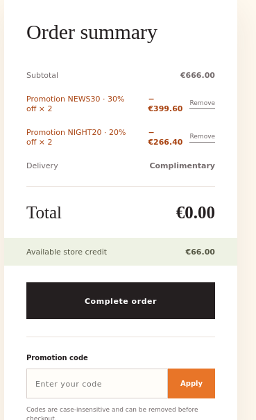
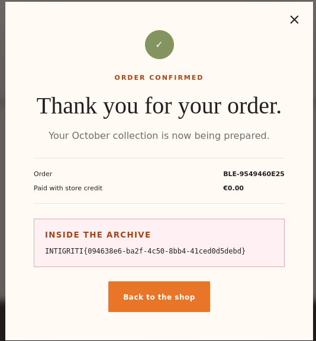

# Business Logic Flaw — Coupon Re-application Bypass Leads to 100% Discount

**Target:** Halloween Store (Intigriti Monthly Challenge — October)
**Class:** Business Logic Error / Improper Coupon Validation (CWE-841: Improper Enforcement of Behavioral Workflow)
**Severity:** Critical — allows full price bypass on any order, including the single-unit "Midnight Collection" item
**Endpoint(s) affected:** `POST /api/cart/coupon`

---

## Summary

The shopping cart's coupon system allows two valid promotion codes (`NIGHT20` and `NEWS30`) to each be re-applied multiple times by alternating between them. This happens because the server only tracks the **last applied coupon code** as a single value when checking for duplicates, rather than maintaining a set of all codes already used on the cart. By applying `NIGHT20`, then `NEWS30`, then `NIGHT20` again, then `NEWS30` again (and repeating), each request passes the "already applied" check — since the *immediately preceding* applied code is different from the one being submitted — and the discount is added again on top of the previous one.

Repeating this cycle a few times stacks the discounts until the cart total reaches **€0.00**, allowing the one-of-a-kind "Midnight Collection" item (€666.00) to be purchased with only **€66.00** of store credit, confirming checkout and revealing the flag.

---

## Coupons Involved

| Code | Discount | Source |
|---|---|---|
| `NIGHT20` | 20% off | Advertised site-wide in the promo banner |
| `NEWS30` | 30% off | Issued automatically after subscribing to the newsletter — **no valid or verified email required**, any arbitrary address works |

Both codes are individually legitimate and intended to be used once. Neither is secret; `NIGHT20` is publicly advertised and `NEWS30` is trivially obtained by submitting any string to the newsletter form.

---

## Root Cause

The server-side duplicate-coupon check appears to compare the incoming coupon code only against **the single most-recently-applied code**, not against the full list/set of codes already present on the cart's `promotions` array. In pseudocode, the vulnerable logic behaves like:

```
if not is_valid_coupon(incoming_code):
    reject("Invalid coupon code.")
elif incoming_code == cart.last_applied_code:
    reject("Coupon already applied.")
else:
    apply_discount(incoming_code)
    cart.last_applied_code = incoming_code   # overwrites, doesn't accumulate
```

Instead of:

```
if not is_valid_coupon(incoming_code):
    reject("Invalid coupon code.")
elif incoming_code in cart.applied_codes_set:
    reject("Coupon already applied.")
else:
    apply_discount(incoming_code)
    cart.applied_codes_set.add(incoming_code)
```

Because only one "last used" value is tracked, alternating between two different codes resets the check every time, and the same coupon can be legitimately re-submitted and re-discounted indefinitely.

---

## Steps to Reproduce

1. Subscribe to the newsletter with any email address (no verification required) to obtain the `NEWS30` code.
2. Add **The Midnight Collection** (€666.00) to the cart.
3. Apply `NIGHT20`:
   ```
   POST /api/cart/coupon
   { "code": "NIGHT20" }
   ```
   → 20% off, total drops to €532.80.
4. Apply `NEWS30`:
   ```
   POST /api/cart/coupon
   { "code": "NEWS30" }
   ```
   → 30% off is applied on top, total drops further.
5. Re-apply `NIGHT20` again. Because the last code applied was `NEWS30`, the duplicate check passes and `NIGHT20`'s discount is applied a second time.
6. Re-apply `NEWS30` again, for the same reason.
7. Repeat steps 5–6, alternating `NIGHT20` / `NEWS30`, until the cart `total` reaches €0.00. (Final cart state showed `NEWS30 × 2` and `NIGHT20 × 2` applied, totaling a 100% discount — see screenshot below.)
8. Submit the order:
   ```
   POST /api/checkout
   ```
9. Checkout succeeds — paid amount €0.00 — and the order confirmation reveals the flag.

---

## Proof of Concept — Evidence

**1. Cart showing both coupons stacked beyond their single intended use, bringing the total to €0.00 against a €666.00 item:**



**2. Order successfully confirmed and paid using only €0.00 of store credit, flag revealed:**



```
INTIGRITI{094638e6-ba2f-4c50-8bb4-41ced0d5debd}
```

---

## Impact

- Complete bypass of pricing/discount limits on any order, not just the Midnight Collection.
- Allows checkout for **€0.00** on an item worth €666.00 using only €66.00 of legitimate credit.
- Since `NEWS30` is obtained with zero verification (any arbitrary email), an attacker needs no privileged state to reach this — only two publicly/trivially obtainable coupon codes and a sequence of ordinary API calls.

---

